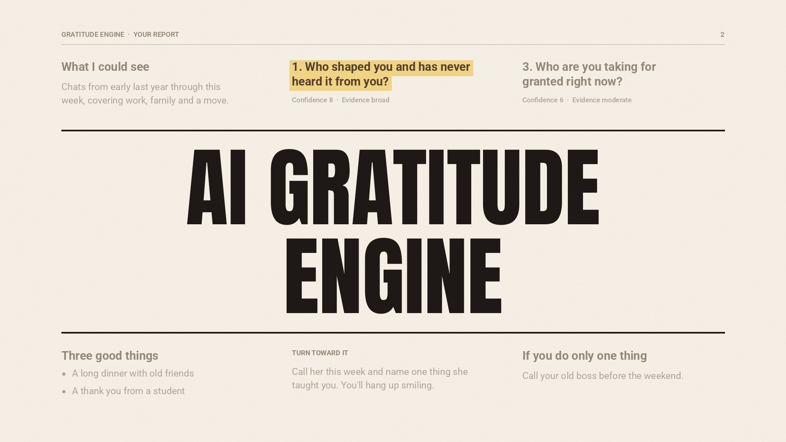

# Gratitude Engine

Gratitude Engine is a single prompt you give to your AI assistant. It reads what the assistant already knows about you, including your past chats, its memory of you and files you've uploaded. Then it shows you what you have to be grateful for. That includes the people, places, abilities and everyday moments you may have stopped noticing.

You get 12 answers. Each one is backed by evidence from your own history and has a confidence score. Each one ends with one thing you could do this week. At the end you get two or three small ways to act on it with the people around you.

You don't need any experience with gratitude to use it.

## How to use it

You need an AI assistant that can remember your past chats, such as ChatGPT, Claude or Gemini.

1. **Download the prompt.** Open [Gratitude-Engine-v0.3.md](Gratitude-Engine-v0.3.md), then click the download button at the top right of the file. It's a small arrow pointing down.
2. **Open the AI account you use most.** Pick the one where you've talked about your life as well as your work. The more it can see, the better the result.
3. **Use the newest model you have.** If your assistant lets you choose how hard it thinks, pick the highest setting. A quick, light model will give you a thin result.
4. **Turn on memory and past-chat search** in your assistant's settings. In ChatGPT, turn on memory and "reference chat history." In Claude, turn on memory and past-chat search. In Gemini, turn on personal context. Without these, the AI can only see one empty chat.
5. **Start a new chat.** If your assistant has projects, start the chat outside them so it can see all your chats.
6. **Attach the file and send this message:**

   ```
   Please evaluate the attached markdown file and complete all tasks.
   ```

7. **Let it run, then read.** It can take a while. Set aside about 20 minutes to read the result, and keep it somewhere private.

**To go further:** run it again inside a project you use a lot, since some projects keep their chats separate. You can also add a line to your message naming people you'd like it to look at closely.

## What you'll get

- A short note on what the AI could and couldn't see
- Five to eight things that keep coming up in your history
- Three good things from your recent life
- 12 questions in three groups: people, gifts beyond people, and three deeper questions
- Two or three small things to try, with no pressure to make any of them a habit
- A short closing summary and the one thing to do in the next 48 hours

## What makes it different

The AI points things out, and you take it from there. Gratitude Engine never writes thank-you notes, messages or scripts for you, and it never offers to. Every suggestion points you toward real people and places.

This follows Julia Freeland Fisher's work at the Christensen Institute on prosocial technology, which means tools that build connection between people. Her report with Anna Arsenault, [Prosocial Possibilities](https://www.christenseninstitute.org/publication/prosocial-possibilities/), asks the people who build AI tools to design them to strengthen human connection.

Gratitude Engine also draws on research showing that people underestimate how much a thank-you means to others, and overestimate how awkward it will feel ([Kumar and Epley, 2018](https://journals.sagepub.com/doi/abs/10.1177/0956797618772506)).

## Inspired by the Reflection Engine

Gratitude Engine grew out of Kevin Rose's [Reflection Engine](https://github.com/kropdx/reflection-engine). His prompt reads your AI history and shows you your blind spots, your habits and where you seem to be headed. I ran it on my own history and wanted the same depth aimed at a different question. What am I grateful for, and who should hear it?

I kept his one-file setup, his evidence standards and his confidence scores. Then I rewrote the questions around gratitude and added one firm rule. The AI never writes your thanks for you.

## Who it's for

Anyone. The prompt tells the AI not to assume your gender, pronouns, relationships, family, faith, income, work, health, home or abilities, and to avoid language that makes you feel guilty.

## Privacy

Gratitude Engine is a prompt, not a product. There's no service, account, install or tracking. It's just a file you attach to a conversation you're already having. Your data stays with the AI provider you already use, and nothing comes back to me.

The output is personal. It draws on your own conversations and names people in your life. Keep it somewhere private.

The prompt tells the AI that someone else wrote it, so the AI won't treat the questions as clues about you. Don't add your name to the file.

## A note on care

This isn't therapy. The prompt tells the AI not to bring up painful subjects you haven't raised yourself, and not to turn hard times into lessons.

## The research behind it

- [Kumar and Epley (2018), Undervaluing Gratitude](https://journals.sagepub.com/doi/abs/10.1177/0956797618772506): people underestimate how much a thank-you means and overestimate how awkward it will be.
- [Algoe, Find, Remind, and Bind](https://www.researchgate.net/publication/264486607_Find_Remind_and_Bind_The_Functions_of_Gratitude_in_Everyday_Relationships): gratitude helps people find, keep and grow closer to good relationships.
- [Koo, Algoe, Wilson and Gilbert (2008), It's a Wonderful Life](https://dtg.sites.fas.harvard.edu/KOO%20ALGOE%20WILSON%20GILBERT%20(2008).pdf): imagining a good thing gone lifts mood more than thinking about how it happened.
- [Grant and Gino (2010), A Little Thanks Goes a Long Way](https://pubmed.ncbi.nlm.nih.gov/20515249/): people who are thanked feel more valued and help more.
- [Seligman, Steen, Park and Peterson (2005), Positive Psychology Progress](https://greatergood.berkeley.edu/images/uploads/Seligman-PosPsychProgress.pdf): the gratitude visit and three good things exercises.

**What it does for you**

- [Chen and colleagues (2024), JAMA Psychiatry](https://jamanetwork.com/journals/jamapsychiatry/fullarticle/2820770): among 49,275 older women, more gratitude was associated with lower mortality.
- [PNAS meta-analysis (2025)](https://www.pnas.org/doi/10.1073/pnas.2425193122): across 24,804 people in 28 countries, gratitude interventions produced small but real gains in well-being.
- [Diniz and colleagues (2023)](https://pubmed.ncbi.nlm.nih.gov/37585888/): higher life satisfaction and better mental health after gratitude interventions.
- [Kirca, Malouff and Meynadier (2023)](https://link.springer.com/article/10.1007/s41042-023-00086-6): a meta-analysis of gratitude that is expressed to others.

The short version: gratitude helps, modestly and reliably, and most when it reaches another person. That's why this engine keeps pointing you outward.

## Credits

Adapted from Kevin Rose's [Reflection Engine](https://github.com/kropdx/reflection-engine), whose structure and evidence standards made this possible. Shaped by Julia Freeland Fisher's [Prosocial Possibilities](https://www.christenseninstitute.org/publication/prosocial-possibilities/) and by research from Amit Kumar, Nicholas Epley and Sara Algoe.

Built by Bob Carlton · [bobcarlton.me](https://bobcarlton.me)
